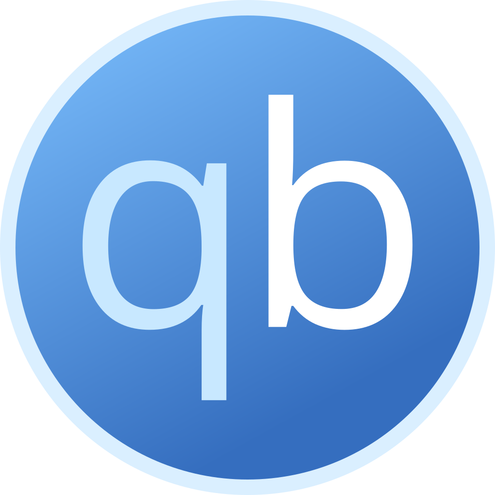
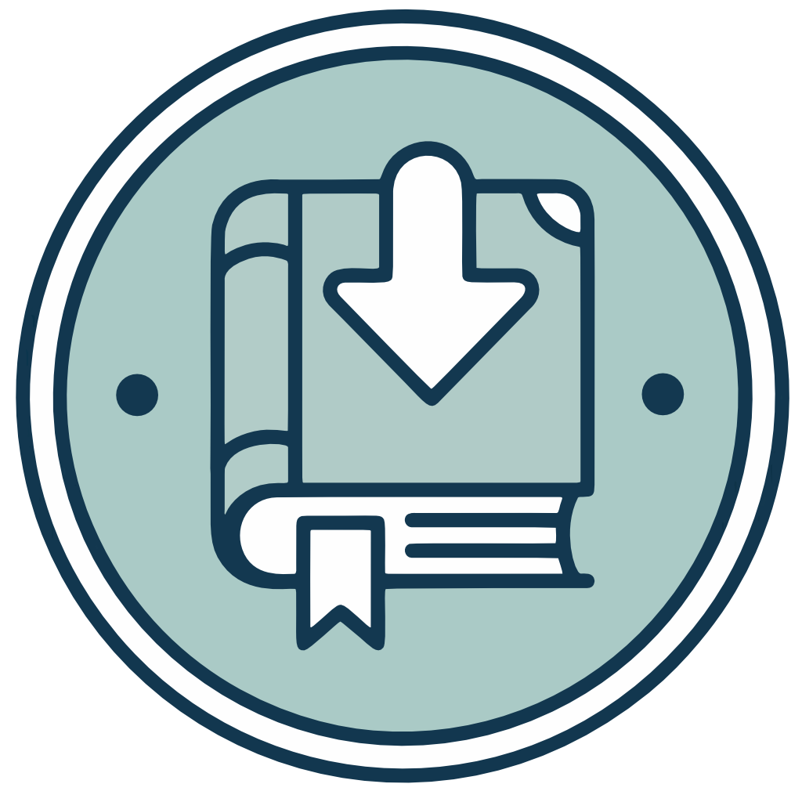
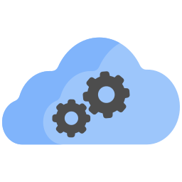
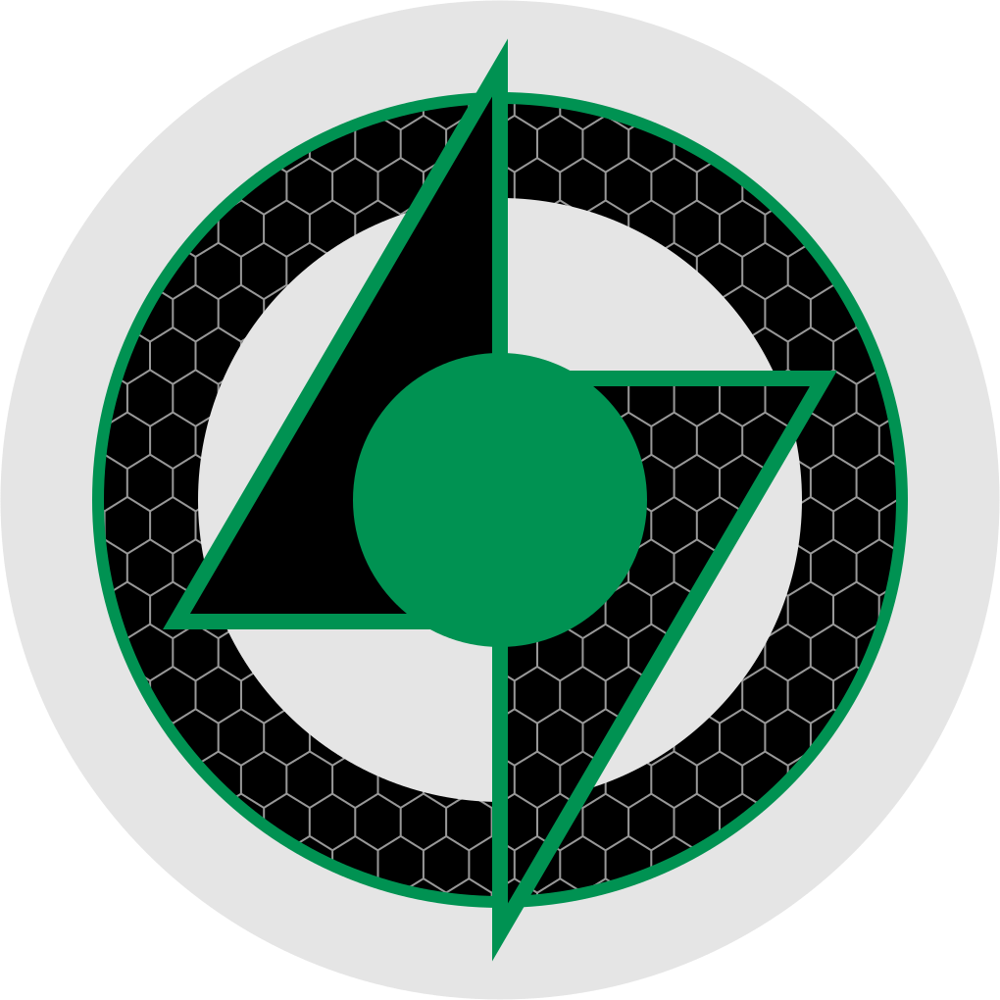
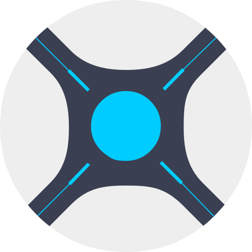

# Installieren

AIO in drei Schritten starten: Ordner anlegen, die App starten, das Dashboard öffnen.

!!! tip "Lieber ein kurzer Weg?"
    Die meisten beginnen mit **[Docker](deploy/DOCKER.md)** oder ihrer NAS-Anleitung (**[Unraid](deploy/UNRAID.md)** · **[Synology](deploy/SYNOLOGY.md)** · **[TrueNAS](deploy/TRUENAS.md)**) und kommen danach für Ports und Updates hierher zurück.

## Bevor Sie anfangen

1. **Wählen Sie, wo es läuft** — Unraid, Synology, TrueNAS, normales Docker oder natives Linux.
2. **Planen Sie zwei Arten von Speicher:**
   - **Config** — Einstellungen und Datenbanken (klein, davon eine Sicherung machen)
   - **Downloads + Medien** — die großen Dateien (auf **derselben** Platte/Freigabe lassen, damit Hardlinks funktionieren)
3. **Kennen Sie Ihre Benutzer-ID** — unter Linux/NAS laufen Apps oft als bestimmter Benutzer (`PUID` / `PGID`). Der muss zum Besitzer Ihrer Ordner passen, sonst gibt es Rechtefehler.

Sie brauchen nur **einen** AIO-Container. Installieren Sie Sonarr, Radarr oder Download-Clients nicht als eigene Apps daneben.

**Image:** `ghcr.io/qballjos/aio-media-server-manager:latest`  
**Architekturen:** `linux/amd64`, `linux/arm64` (Flaresolverr ist nur x86_64 und auf ARM ausgeblendet)

## Plattform wählen

| Wo es läuft | Anleitung |
|------------------|--------|
| Docker (jeder Host) | [Docker](deploy/DOCKER.md) |
| Unraid | [Unraid](deploy/UNRAID.md) |
| Synology | [Synology](deploy/SYNOLOGY.md) |
| TrueNAS SCALE | [TrueNAS](deploy/TRUENAS.md) |
| Debian / Ubuntu / Proxmox LXC (ohne Docker) | [Linux](deploy/LINUX.md) |
| Alle Möglichkeiten | [Überblick](deploy/README.md) |

Jede Plattform-Anleitung beginnt mit: SSH öffnen → Ordner anlegen → AIO starten.

## Ordner auf dem Host

Per SSH anmelden und etwa dies anlegen (Pfade hängen von der Plattform ab — folgen Sie Ihrer Anleitung):

```bash
ssh user@host

mkdir -p "$HOME/aio-media-manager/downloads" "$HOME/aio-media-manager/media"
sudo mkdir -p /path/to/config /path/to/config/vpn /path/to/backups
id   # note uid= (PUID) and gid= (PGID)
sudo chown -R "$PUID:$PGID" "$HOME/aio-media-manager" /path/to/config /path/to/backups
```

**Downloads** und **Medien** als Geschwister unter einem Ordner lassen, damit *Arr Hardlinks nutzen kann. Einen eigenen Ordner **backups** nach `/backups` einhängen, wenn möglich (besser eine andere Platte als die Config).

In diesen Mounts legt AIO Bibliotheken an, etwa `media/tv`, `media/movies` und `downloads/complete`.

## Nach dem Start

1. Dashboard öffnen: `http://YOUR-SERVER-IP:8080`  
   (Anderen Port nutzen, wenn Sie einen gemappt haben.)
2. Administratorkonto anlegen (Benutzername, **E-Mail**, Passwort).
3. Den Assistenten der Ersteinrichtung abschließen und danach [Das Dashboard nutzen](USAGE.md) folgen.

Nach `docker compose pull` den Container **neu erstellen** (nicht nur neu starten), damit neue Ports und Laufzeiten gelten. Das aktualisiert AIO. Installierte Apps aktualisieren Sie unter **Einstellungen → Updates** im Dashboard. Diese Zeitpläne sind standardmäßig aus.

Die Compose-Datei des Repos hängt Host-`/sys` nur lesend unter `/host/sys` ein, damit die Server-Karte auf Start die Netzwerkkarten des Servers zählt. Eine ältere Compose-Datei ohne diese Zeile zeigt nur den Verkehr des Containers, bis Sie die Zeile ergänzen und neu erstellen. Siehe [Docker](deploy/DOCKER.md).

## Optional: Apps von außerhalb erreichen

1. [Cloudflare Tunnel](deploy/CLOUDFLARE.md) — HTTPS, ohne Routerports zu öffnen  
2. [Cloudflare Access](deploy/CLOUDFLARE_ACCESS.md) — eine Anmeldung, damit Fremde die Admin-Apps nicht öffnen können

## Ports {#ports}

Die Oberfläche des Managers nutzt **8080**. Kind-Apps lauschen im selben Container. Compose und NAS-Vorlagen veröffentlichen diese Ports auf dem Host, damit **Oberfläche öffnen** funktioniert (`http://YOUR-IP:8989` für Sonarr und so weiter). Host-Netzwerk ist eine Alternative, wenn Sie nicht jeden Port mappen wollen.

| Anwendung | Standardport |
|-------------|--------------|
|  Manager-Oberfläche | 8080 |
|  qBittorrent | 8081 |
|  Shelfmark | 8084 |
|  SABnzbd | 8085 |
|  Jellyfin | 8096 |
|  Flaresolverr | 8191 (nur x86_64) |
|  Bazarr | 6767 |
|  NZBGet | 6789 |
|  Lidarr | 8686 |
|  Sonarr | 8989 |
|  Radarr | 7878 |
|  Prowlarr | 9696 |
|  Seerr | 5055 |
|  Grimmory | 6060 |
|  NeutArr | 9705 |
|  Recyclarr | keine (nur CLI) |
|  Plex | 32400 |

## Häufige Umgebungsvariablen

Kopieren Sie [`.env.example`](../.env.example) für native Installationen. Vieles davon lässt sich später auch unter **Einstellungen** setzen.

| Variable | Zweck |
|----------|---------|
| `PUID` / `PGID` | Benutzer, als der die Apps laufen (muss zum Ordnerbesitzer passen) |
| `TZ` / `AMM_TIMEZONE` | Zeitzone für Protokolle und Zeitpläne |
| `AMM_DOWNLOAD_DIR` / `AMM_MEDIA_DIR` | Pfade im Container (Host-Mounts ändern Sie in Compose) |
| `GITHUB_TOKEN` | Optional; höheres GitHub-API-Limit für Updates |
| `AMM_CLOUDFLARE_TUNNEL_*` | Optionaler Tunnel für Fernzugriff (`cloudflared` startet nach den Apps beim Boot) |
| `AMM_VPN_*` | Optionales VPN für qBittorrent, Prowlarr und Flaresolverr (sie warten auf den Tunnel; lokaler DNS-Cache für diese Apps) |

## Wenn etwas schiefgeht

- **Oberfläche öffnet nicht** — läuft der Container? Stimmt der Host-Port?
- **Zugriff verweigert** — der Ordnerbesitzer muss zu `PUID`/`PGID` passen.
- **Oberfläche öffnen einer Kind-App scheitert im LAN** — diesen App-Port veröffentlichen (Tabelle oben) oder Host-Netzwerk nutzen; alte Compose-Dateien, die nur `8080` mappen, müssen aktualisiert werden.
- **Apps doppelt** — eigene Sonarr-/Radarr-Container entfernen; nur AIO soll sie ausführen.

## Entwicklung

Um am Code zu arbeiten, den Checkout **in Docker** laufen lassen (Linux-Binaries). Siehe [Contributing](../CONTRIBUTING.md) und `./scripts/test-env.sh up`.
