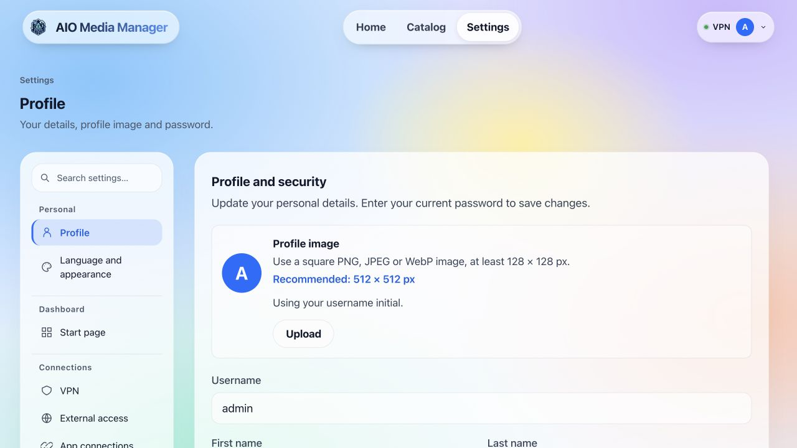

# AIO Schritt für Schritt benutzen

Sobald AIO im Browser erreichbar ist, beginne hier. Zuerst eine App zum Laufen bringen, dann weitere hinzufügen.

## 1. Ersteinrichtung abschließen

Administratorkonto erstellen und den Assistenten abschließen. Beginne etwa mit Jellyfin für vorhandene Medien. VPN und Fernzugriff vorerst auslassen. Warte auf Running im Katalog.

## 2. Die drei Seiten

| AIO | |
|---|---|
| Home | Downloads, Termine und Serverdaten; Widgets lassen sich anordnen. |
| Katalog | Apps installieren, Status prüfen und über Open UI öffnen. |
| Einstellungen | Aussehen, Konto und Updates von AIO; hier werden keine Filme zu einer Medienbibliothek hinzugefügt. |

## In den Einstellungen zurechtfinden {#settings-menu}

Öffne oben **Einstellungen**. Am Computer wählst du links eine Seite. Mit **Einstellungen suchen…** findest du zum Beispiel Hintergrund oder Sicherungen. Lösche die Suche, um wieder alle Seiten zu sehen. Auf dem Telefon öffnest du das Menü über **Einstellungen / aktuelle Seite**.

| Was möchtest du ändern? | Diese Seite wählen |
|---|---|
| Name, Profilbild oder Passwort | Persönlich → **Profil** |
| Sprache, Thema oder Hintergrund | Persönlich → **Sprache und Darstellung** |
| App-Leiste oder Anmeldetext | Dashboard → **Startseite** |
| Eine App aktualisieren | Wartung → **Updates** |
| Einstellungen sichern | Wartung → **Sicherungen** |
| Grund für ein leeres Widget finden | System → **Hilfe und Diagnose** |

Die Seitenleiste öffnet nur eine Seite. Ändere rechts die gewünschte Option und nutze die jeweilige Schaltfläche **Speichern**, sofern angezeigt. Widgets ordnest du direkt auf **Start** über das Symbol mit vier Blöcken an; Startseite regelt die App-Leiste und den Anmeldetext.



## 3. Erste App öffnen

Im Katalog Jellyfin suchen und Open UI wählen. Jellyfins eigenen Assistenten gegebenenfalls abschließen. Bei der Standardinstallation sind die Bibliotheksordner /data/media/movies für Filme und /data/media/tv für Serien. Diese entsprechen den verbundenen NAS-Ordnern; wegen anderer Pfadnamen keine zweite Medienkopie erstellen.

**Prüfen: Jellyfin öffnet in einem eigenen Tab. Ohne Mediendateien ist die Bibliothek leer; das ist normal.**

## 4. Ersten Film abspielen {#first-media}

Nimm eine vorhandene eigene Filmdatei und kopiere sie in den **movies-Ordner des Servers**, nicht Downloads und nicht die Website-Demo.

| Server | Zielordner |
|---|---|
| Synology | DSM File Station → home → aio-media-manager → media → movies. Upload wählen und die Datei vom Computer auswählen. |
| Unraid | Netzfreigabe aio-media-manager → media → movies. Die letzte Unraid-Anleitungsstufe richtet die private Freigabe ein. |
| TrueNAS | Netzfreigabe aio-media → media → movies. Schritt 7 der TrueNAS-Anleitung richtet den Zugriff ein. |
| Docker auf Linux | Auf dem Server Home → aio-media-manager → media → movies. Von einem anderen Computer geht es über SSH mit scp, siehe unten. |

Für einen entfernten Linux-Server diesen Befehl **auf deinem Computer** ausführen. Dateipfad, Benutzer und Server-IP ersetzen. Das Ziel entspricht der Standardinstallation im Home-Ordner.

Ein Windows-Pfad sieht etwa wie `C:\Users\Alex\Videos\MeinFilm.mp4` aus, ein Mac-Pfad wie `/Users/alex/Movies/MeinFilm.mp4`. Anführungszeichen um deinen echten Pfad behalten und dieselben Serverdaten wie bei SSH verwenden.

```bash
scp "/PATH/TO/YOUR/FILM.mp4" YOUR-USER@SERVER-IP:aio-media-manager/media/movies/
```

Serien kommen nach media/tv. Nach dem Kopieren unter Jellyfin → Dashboard → Bibliotheken Scan All Libraries bzw. die Bibliothek scannen wählen. Zur Jellyfin-Startseite zurückkehren, den Film öffnen und Play wählen.

**Prüfen: Film erscheint und läuft. Sonst Serverordner und den in Jellyfin gewählten Pfad vergleichen und erneut scannen.**

## 5. Home-Widgets anordnen {#customize-home}

<div class="widget-visual-guide" role="group" aria-label="Widgets auf Home anordnen">
<div class="widget-visual-step"><span class="visual-number">1</span><strong>Der Layoutknopf</strong><div class="visual-nav"><span>Home</span><span>Catalog</span><span>Settings</span><span class="visual-highlight"><svg viewBox="0 0 24 24" fill="none" stroke="currentColor" stroke-width="1.7" aria-hidden="true"><rect x="3" y="3" width="7" height="10" rx="1.5"/><rect x="14" y="3" width="7" height="6" rx="1.5"/><rect x="3" y="17" width="7" height="4" rx="1.5"/><rect x="14" y="13" width="7" height="8" rx="1.5"/></svg></span></div><p>Wähle auf Home das Symbol mit vier Blöcken neben den Seitentabs. Griffe und eine Bearbeitungsleiste erscheinen.</p></div>
<div class="widget-visual-step"><span class="visual-number">2</span><strong>Verschieben: Griff ziehen</strong><div class="visual-widget"><span class="visual-grip">⠿</span><span class="visual-remove">×</span><strong>Downloads</strong><span class="visual-widget-line"></span><span class="visual-widget-line short"></span><span class="visual-corner">↘</span></div><p>Größe: diese Ecke ziehen</p></div>
<div class="widget-visual-step"><span class="visual-number">3</span><strong>Widget auswählen</strong><div class="visual-toolbar"><span>＋ Widget hinzufügen</span><span>Fertig</span></div><p>Wähle Widget hinzufügen, dann Diese Größe oder Jede Größe und das Widget. Änderungen werden automatisch gespeichert; beende mit Fertig.</p></div>
</div>

[Home-Widgets anordnen](index.md#app-preview){ .md-button .md-button--primary }

Die Bilder erklären die echten Bedienelemente. Die Website-Demo verwendet Beispieldaten und ändert dein Dashboard nicht.

### Warum ist ein Widget leer?

Zuerst die zugehörige App im Katalog prüfen. Neue Medien brauchen Inhalte in Jellyfin/Plex; der Kalender geplante Titel verbundener Apps. Leere Widgets können außerhalb des Editors verschwinden. Ein hinzugefügtes Widget installiert nicht seine Quell-App.

## 6. Wozu dienen die anderen Apps?

| App | |
|---|---|
| Jellyfin / Plex | Vorhandene Medien abspielen. |
| Sonarr / Radarr | Serien / Filme ordnen und ausgewählte Downloads automatisieren. |
| SABnzbd / NZBGet | Usenet-Downloads mit eigenem Providerkonto. |
| qBittorrent | Torrents herunterladen und teilen. |
| Prowlarr | Suchquellen der Automatisierungsapps verwalten. |

Nicht alle Apps werden benötigt. Weitere erst bei Bedarf im Katalog hinzufügen. Verbindungen erklärt die fortgeschrittene Anleitung.

## 7. Apps aktualisieren

Unter Einstellungen → Updates werden die Apps innerhalb AIO aktualisiert. AIO selbst wird getrennt über NAS/Docker aktualisiert; siehe fortgeschrittene Plattformanleitung. Vor Änderungen unter Einstellungen → Backups eine Konfigurationssicherung erstellen.

## Screenshots und technische Referenz {#screens}

[Screenshots und technische Referenz](USAGE_ADVANCED.md#screens).

## Fortgeschritten

Eigene Verbindungen, VPN, Schlüssel und Diagnosen stehen in der fortgeschrittenen Dashboard-Anleitung. [Fortgeschritten](USAGE_ADVANCED.md).
