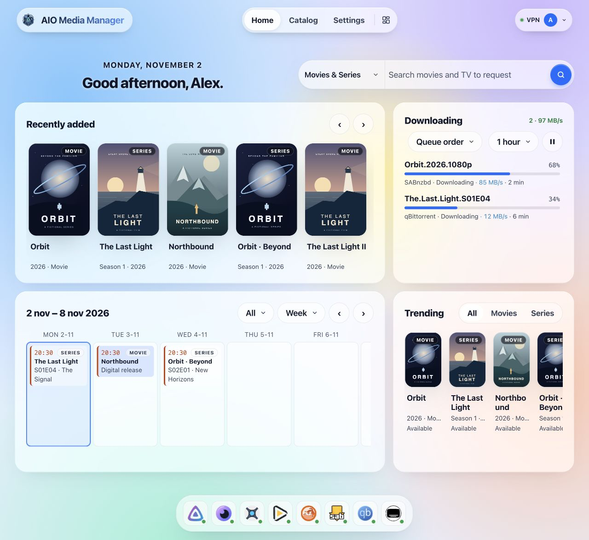
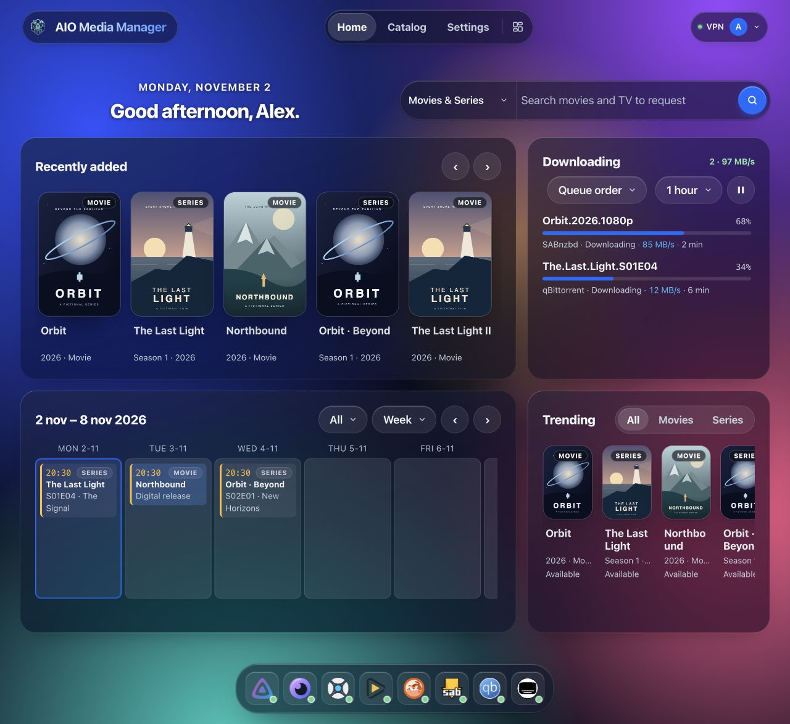

# Das Dashboard nutzen — Fortgeschritten

!!! info "Fortgeschritten"
    Dies ist die technische Referenz. Für die erste Installation nutze die Einsteigeranleitung. [Einsteigeranleitung](USAGE.md).

Dieser Leitfaden gilt, nachdem AIO installiert ist und Sie die Weboberfläche öffnen können.

!!! success "Ziel"
    Schließen Sie den Assistenten für die Apps ab, die Sie brauchen, nutzen Sie Start im Alltag und **Öffnen** im Katalog, wenn Sie den Bildschirm dieses Werkzeugs wollen.

Standardadresse im Heimnetz:

```text
http://YOUR-SERVER-IP:8080
```

Ersetzen Sie die IP (und den Port, wenn Sie ihn geändert haben).

---

## Erste Schritte

1. Legen Sie das **Administrator**konto an, wenn Sie dazu aufgefordert werden (Benutzername, **E-Mail**, Passwort).
2. Schließen Sie den Assistenten der Ersteinrichtung ab: die gewünschten Apps, einen Usenet-Server, falls Sie einen nutzen, optional VPN und einen optionalen Cloudflare Tunnel. Der Assistent installiert diese Auswahl. Tunnel und VPN starten, sobald der Assistent fertig ist, wenn Sie sie eingeschaltet haben.
3. Nach dem Neuanlegen des Containers antwortet das Dashboard, während Apps noch starten. Mit VPN an warten qBittorrent, Prowlarr und Flaresolverr auf den WireGuard-Handshake (AIO versucht das VPN erneut, wenn der erste Versuch scheitert). Cloudflare Tunnel startet zuletzt, nachdem die Apps antworten, damit cloudflared kein connection refused gegen Origins loggt, die noch nicht lauschen.
4. Warten Sie, bis **Katalog** diese Apps als **aktiv** zeigt. Nutzen Sie **Öffnen** für alles, das noch ein eigenes Konto hat (Plex, Jellyfin, NZBGet).
5. Später fügen Sie mehr über **Katalog** hinzu. Sie brauchen nicht jede App.

Fangen Sie klein an (zum Beispiel Radarr + ein Download-Client + Jellyfin) und ergänzen Sie den Rest danach.

---

## Widgets auf Home anordnen {#customize-home}

<div class="widget-visual-guide" role="group" aria-label="Widgets auf Home anordnen">
<div class="widget-visual-step"><span class="visual-number">1</span><strong>Der Layoutknopf</strong><div class="visual-nav"><span>Home</span><span>Catalog</span><span>Settings</span><span class="visual-highlight"><svg viewBox="0 0 24 24" fill="none" stroke="currentColor" stroke-width="1.7" aria-hidden="true"><rect x="3" y="3" width="7" height="10" rx="1.5"/><rect x="14" y="3" width="7" height="6" rx="1.5"/><rect x="3" y="17" width="7" height="4" rx="1.5"/><rect x="14" y="13" width="7" height="8" rx="1.5"/></svg></span></div><p>Wähle auf Home das Symbol mit vier Blöcken neben den Seitentabs. Griffe und eine Bearbeitungsleiste erscheinen.</p></div>
<div class="widget-visual-step"><span class="visual-number">2</span><strong>Verschieben: Griff ziehen</strong><div class="visual-widget"><span class="visual-grip">⠿</span><span class="visual-remove">×</span><strong>Downloads</strong><span class="visual-widget-line"></span><span class="visual-widget-line short"></span><span class="visual-corner">↘</span></div><p>Größe: diese Ecke ziehen</p></div>
<div class="widget-visual-step"><span class="visual-number">3</span><strong>Widget auswählen</strong><div class="visual-toolbar"><span>＋ Widget hinzufügen</span><span>Fertig</span></div><p>Wähle Widget hinzufügen, dann Diese Größe oder Jede Größe und das Widget. Änderungen werden automatisch gespeichert; beende mit Fertig.</p></div>
</div>

[Interaktive Demo ausprobieren](index.md#app-preview){ .md-button .md-button--primary }

Hier sind die echten Bedienelemente erklärt; die Website-Demo nutzt Beispieldaten und vereinfachte Bewegungen.

Klicke im Editor ein Widget an, um Größen auszuwählen. × entfernt es aus der gewählten Bildschirmgröße; mit Rückgängig kannst du eine falsche Entfernung sofort zurücknehmen.

Änderungen werden automatisch im AIO-Profil gespeichert; Fertig beendet den Editor. Handy, Tablet und Desktop können eigene Layouts haben. Größenknöpfe erscheinen nur, wenn das Fenster diese Vorschau zeigen kann.

!!! tip "Dashboard"
    Bei leeren Karten zuerst die Quell-App im Katalog prüfen. Einstellungen → Hilfe und Diagnose → Explain empty widgets zeigt mögliche Gründe. Die Dock-Einstellung liegt unter Einstellungen → Startseite; das Aussehen änderst du unter Sprache und Darstellung.

Mit Tastatur: Tab zum Widget, Pfeile verschieben, Shift + Pfeile ändern die Größe, Enter öffnet Größen und Delete entfernt es.


## Start

Start ist ein Raster. Telefon, Tablet und Desktop behalten jeweils ihr eigenes Layout (4, 8 und 12 Spalten). Die Layout-Schaltfläche auf dem Start-Reiter verschiebt, vergrößert, fügt hinzu und entfernt Widgets. **Einstellungen → Startseite** regelt die App-Leiste und den Anmeldetext. API-Schlüssel stehen unter **Einstellungen → App-Verbindungen**.

| Widget | Was es zeigt |
|--------|----------------|
| Begrüßung | Tageszeit |
| Suche | Suche in Seerr |
| Kalender | Kommende Folgen und Filme. Eine Staffel, die an einem Tag startet, ist eine Zeile |
| Downloads | Aktive Downloads, mit alles pausieren / alles fortsetzen. Hängende Einträge können Sie entfernen |
| Zuletzt hinzugefügt | Neue Serien und Filme. Scrollen lädt weitere Jellyfin-Seiten. Plex bleibt bei den letzten 20 |
| Anfragen | Seerr-Anfragen, die noch nicht fertig sind, plus was in den letzten 30 Tagen als verfügbar oder abgelehnt markiert wurde |
| Trending | Die Trending-Liste von Seerr. Scrollen lädt weiter |
| Wird abgespielt | Wer auf Jellyfin oder Plex schaut, inklusive Direktwiedergabe |
| Speicher | Plattennutzung von Config, Downloads und Medien |
| Server | CPU, Arbeitsspeicher und Netzwerk. Mit Host-`/sys` unter `/host/sys` sind das die Netzwerkkarten des Servers. Ohne diesen Mount nur der Verkehr dieses Containers |
| Braucht Aufmerksamkeit | Dieselben Prüfungen wie Einstellungen → Benachrichtigungen, mit einem Link, jeden Punkt zu beheben |
| Andere Downloads | Standardmäßig aus; über die Layout-Steuerung hinzufügen. Was SABnzbd, NZBGet und qBittorrent heruntergeladen haben, das kein Film und keine Serie ist (Musik, Bücher, Spiele, Software, Archive), jeweils mit einem Symbol für die Art |

Installieren, starten, stoppen und **Öffnen** liegen im **Katalog**. Die Leiste unten auf Start öffnet Apps, die schon installiert sind.

**Öffnen** im LAN sieht meist so aus: `http://YOUR-SERVER-IP:8989` (Beispiel Sonarr).
Wenn Sie öffentliche Cloudflare-Hostnamen eingerichtet haben, kann **Öffnen** stattdessen `https://sonarr.yourdomain.com` nutzen — siehe [Cloudflare Tunnel](deploy/CLOUDFLARE.md).

---

## Was der Assistent verknüpft

Sobald eine App gesund ist — oder wenn Sie **Auto-Verknüpfen** klicken — setzt AIO Download-Ordner und Kategorien, Stammordner und Download-Clients in Sonarr, Radarr und Lidarr, Prowlarr-Sync, Seerr, die Bazarr-Verknüpfung und die Startkonfigurationen von Recyclarr und NeutArr. **Einstellungen → Usenet** speichert den Newsserver und schickt ihn an SABnzbd und NZBGet. Prowlarr bekommt außerdem einen Startsatz öffentlicher Indexer. Entfernen Sie, was Sie nicht wollen; sie werden nicht wieder hinzugefügt.

SSD-Staging und HDD-Bibliothek werden unterstützt; Importe dazwischen kopieren Dateien. Hardlinks erfordern dasselbe Dateisystem.

Noch selbst zu erledigen:

- Ein Plex-Konto.
- Das Einrichtungs-Token des ersten NeutArr-Starts (unten), bis dieses Konto existiert.
- Anmeldung bei Jellyfin und NZBGet. Im LAN meldet **Öffnen** Sie bereits bei Sonarr, Radarr, Lidarr, Prowlarr, qBittorrent, SABnzbd, Bazarr und Seerr als Administrator des Managers an. Öffentliche Hostnamen zeigen immer die eigene Anmeldung der App.
- Administrator und Assistent der Ersteinrichtung von Seerr werden für Sie aus dieser gemeinsamen Anmeldung abgeschlossen (über Jellyfin oder ein beanspruchtes Plex).

VPN, Cloudflare Tunnel, Recyclarr, NeutArr und Sicherungen sind optional.

### Einrichtungs-Token des ersten NeutArr-Starts

Beim ersten Start von NeutArr, bevor es ein Konto hat, verlangt es ein einmaliges Einrichtungs-Token.

1. Warten Sie, bis NeutArr **aktiv** ist.
2. Öffnen Sie **Katalog → NeutArr → Einstellungen**.
3. Kopieren Sie **Token für die Ersteinrichtung** und fügen Sie es in den Einrichtungsbildschirm von NeutArr ein.

Dieser Wert ist die Datei `/config/neutarr/.setup-token` im Gerät (der Host-Ordner, der als `/config` eingehängt ist). NeutArr löscht die Datei, nachdem das Konto angelegt wurde, und das Feld in Einstellungen wird leer. Solange NeutArr nicht gestartet ist, bleibt das Feld leer.

---

## Die Oberfläche jeder App öffnen

| Situation | Was Sie nutzen |
|-----------|-------------|
| Zu Hause im WLAN | **Öffnen** → `http://IP:PORT` |
| Unterwegs mit Cloudflare | **Öffnen** → `https://subdomain.yourdomain.com` |
| Sie haben den Lauschport einer App geändert | AIO aktualisiert veröffentlichte Routen; erstellen Sie den Container neu, wenn LAN-Links noch falsch aussehen. Der Port des Managers selbst ist Compose/Umgebung (`AMM_API_PORT`), sichtbar unter **Einstellungen → Server und Speicher** |

Wenn **Öffnen** scheitert:

- Ist die App im Katalog **aktiv**?
- Sind Sie im selben Netz (für LAN-Links)?
- Für HTTPS-Links: ist der Tunnel verbunden und **Veröffentlichen** gelungen? ([Cloudflare-Anleitung](deploy/CLOUDFLARE.md))

---

## Den neuen Katalog benutzen {#catalog-menu}

Öffne oben **Katalog**. Links wählst du die Ansicht, rechts erscheinen die Apps.

Name, Symbol oder Zeile einer App öffnen das **App-Einstellungsfenster**, nicht die App selbst. **⋯** bietet je nach Status Einstellungen, Stoppen, Neustarten, Logs, Aktualisieren und Deinstallieren. Mit × oder Escape schließen. Änderungen nur bewusst speichern.

**App-Einstellungen im Katalog** gelten für eine App. Die Seite **Einstellungen** oben ändert AIO selbst: Profil, Aussehen, Verbindungen, Sicherungen und Updates.

[Den neuen Katalog benutzen](USAGE.md#catalog-menu).

Einstellungen nutzt dieselbe Seitenleiste wie der Katalog: links Gruppe und Seite wählen, rechts bearbeiten. Die Suche filtert das Menü, nicht gespeicherte Werte. Für weitere Gruppen in der Seitenleiste scrollen. Auf dem Telefon **Einstellungsbereiche** öffnen und eine Seite wählen.

## Einstellungen, die Sie wirklich nutzen

Namen in der Oberfläche können kurz sein; das ist, was sie in der Praxis bedeuten.

| Diese Seite wählen | Was möchtest du ändern? |
|---|---|
| **Profil** | Konto, Bild und Passwort. |
| **Sprache und Darstellung** | Sprache, Thema, Hintergrund und eigene Logos. |
| **Startseite** | App-Leiste und Anmeldetext; Widgets direkt auf Start anordnen. |
| **VPN** | VPN-Verbindung unterstützter Apps. |
| **Externer Zugriff** | Cloudflare Tunnel, öffentliche Adressen und vertrauenswürdige Proxys. |
| **App-Verbindungen** | Jellyfin-/Seerr-Schlüssel, TV-Kopplung und schreibgeschützter Homey-Zugang. |
| **Usenet** | Providerdaten für SABnzbd und NZBGet. |
| **Updates** | App-Updates und Zeitpläne. AIO selbst über NAS/Docker aktualisieren. |
| **Sicherungen** | Konfiguration sichern, prüfen, planen und wiederherstellen. |
| **Benachrichtigungen** | E-Mail- und Discord-Meldungen. |
| **Server und Speicher** | Zeitzone, Logs, Berechtigungen und Speicherpfade. Mounts auf dem Server ändern. |
| **Hilfe und Diagnose** | Leere Widgets erklären und Diagnosedaten sammeln. |
| **Über diese App** | Version, Installation auf deinem Gerät und Projektunterstützung. |

Geben Sie Apps nach einer wichtigen Netzwerk- oder Portänderung etwas Zeit zum Neuladen — oder starten Sie AIO neu, wenn Links veraltet bleiben.

## Bildschirme {#screens}

Aktuelle App mit fiktiven Beispieldaten. Links hell, rechts dunkel. Die gefüllte Startseite zeigt Poster, Downloads und Veröffentlichungstermine. Die Screenshots verwenden englische Menünamen.

### Dashboard

| Light | Dark |
|---|---|
|  |  |

### Externer Zugriff

| Light | Dark |
|---|---|
|  |  |

### App-Verbindungen

| Light | Dark |
|---|---|
|  |  |

### Über diese App

| Light | Dark |
|---|---|
|  |  |

### Profil

| Hell | Dunkel |
| --- | --- |
|  |  |

### Sprache und Darstellung

| Hell | Dunkel |
| --- | --- |
|  |  |

### Server und Speicher

| Hell | Dunkel |
| --- | --- |
|  |  |

### Updates

| Hell | Dunkel |
| --- | --- |
|  |  |

### Sicherungen

| Hell | Dunkel |
| --- | --- |
|  |  |

### VPN

| Hell | Dunkel |
| --- | --- |
|  |  |

### Benachrichtigungen

| Hell | Dunkel |
| --- | --- |
|  |  |

### Usenet

| Hell | Dunkel |
| --- | --- |
|  |  |

### Startseite

| Hell | Dunkel |
| --- | --- |
|  |  |

### Hilfe und Diagnose

| Hell | Dunkel |
| --- | --- |
|  |  |

### App-Einstellungen im Katalog

| Hell | Dunkel |
| --- | --- |
|  |  |

---

## Sicherungen

- Nutzen Sie die eingebaute Sicherung, wenn Sie eine Einrichtung behalten wollen.
- Sichern Sie auch den **Config**-Ordner auf dem Host (und den Backup-Mount, falls Sie einen nutzen).
- Mediendateien liegen getrennt — sichern Sie sie mit Ihrer normalen NAS- oder Plattenstrategie.

---

## Apps aktualisieren und AIO aktualisieren

| Was | Wie |
|------|-----|
| **AIO selbst** (Dashboard + Supervisor) | Holen Sie ein neues Docker-Image und **erstellen Sie den Container neu** ([Installieren](INSTALL.md)). Einstellungen → Updates sagt nur, wann `:latest` sich verschoben hat |
| **Installierte Apps** (Sonarr, Seerr und der Rest) | **Einstellungen → Updates**. Aktualisieren Sie eine App oder alle. Der Fortschritt steht dort, und Katalog und Start zeigen **Wird aktualisiert…**. Das Dashboard antwortet weiter. Zeitpläne sind standardmäßig **aus** |

Das Image aktualisiert diese Apps nicht von allein. Lesen Sie die Release-Hinweise auf GitHub, wenn sich etwas Großes geändert hat.

---

## Häufige Stolperstellen

| Problem | Versuchen Sie dies |
|---------|----------|
| Leerer Bildschirm oder Anmeldeschleife bei einer App | Löschen Sie die Website-Daten dieser URL; prüfen Sie, ob die App läuft |
| NeutArr verlangt ein Einrichtungs-Token | **Katalog → NeutArr → Einstellungen**, nachdem NeutArr läuft. Das Token verschwindet, sobald das NeutArr-Konto existiert |
| Rechtefehler beim Schreiben von Dateien | Der Besitzer des Host-Ordners muss zum Container-Benutzer passen (`PUID`/`PGID`) |
| Sonarr importiert, kopiert die Dateien aber | Downloads und Medien müssen ein Dateisystem teilen, damit Hardlinks funktionieren |
| Funktioniert zu Hause, nicht über Mobilfunk | Tunnel nötig (+ möglichst Access); LAN-IPs sind über Mobilfunk nicht erreichbar |
| Zwei Sonarrs im Konflikt | Entfernen Sie einen zusätzlichen Sonarr-Container; nur AIO soll ihn ausführen |
| Die Server-Grafik zählt nur diesen Container | Hängen Sie Host-`/sys` nur lesend unter `/host/sys` ein und erstellen Sie neu ([Docker](deploy/DOCKER.md)) |
| Zuletzt hinzugefügt von Jellyfin wirkt kurz | Scrollen Sie die Zeile — weitere Seiten werden geladen. Bleibt die Zeile leer, setzen Sie einen Jellyfin-API-Schlüssel unter **Einstellungen → App-Verbindungen** |
| Zuletzt hinzugefügt von Plex stoppt bei 20 | Diese Liste sind die letzten 20 von Plex |
| qBittorrent / Prowlarr / Flaresolverr bleiben nach dem Boot gestoppt | VPN ist an ohne Live-Handshake. Prüfen Sie **Einstellungen → VPN**; AIO versucht den Tunnel erneut und startet diese Apps, sobald er wieder da ist. Ein manuelles VPN-**Stop** bricht den Retry ab |
| Prowlarr-Indexer nicht verfügbar / RSS-Fehler | Oft ein DNS-Timeout durch den VPN. Nach einem AIO-Update den Container neu anlegen, dann in Prowlarr **Test All** (und in Sonarr/Radarr erneut testen), damit der alte Fehler-Backoff weg ist. Ein Debug-Share zeigt Treffer des VPN-DNS-Caches und Fehler je Resolver |
| cloudflared loggt connection refused beim Boot | Erwartet bei älteren Images, als der Tunnel vor den Apps startete. Aktuelle Images starten Cloudflare zuletzt; neu anlegen von aktuellem `nightly` / `latest` |

---

## Nächste Schritte

- Checkliste für eine neue Installation: [Installieren](INSTALL.md)
- Fernzugriff: [Cloudflare Tunnel](deploy/CLOUDFLARE.md)
- Die Tür für öffentliche URLs schließen: [Cloudflare Access](deploy/CLOUDFLARE_ACCESS.md)
