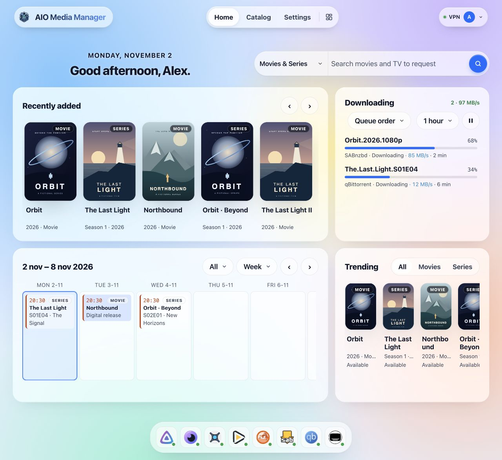
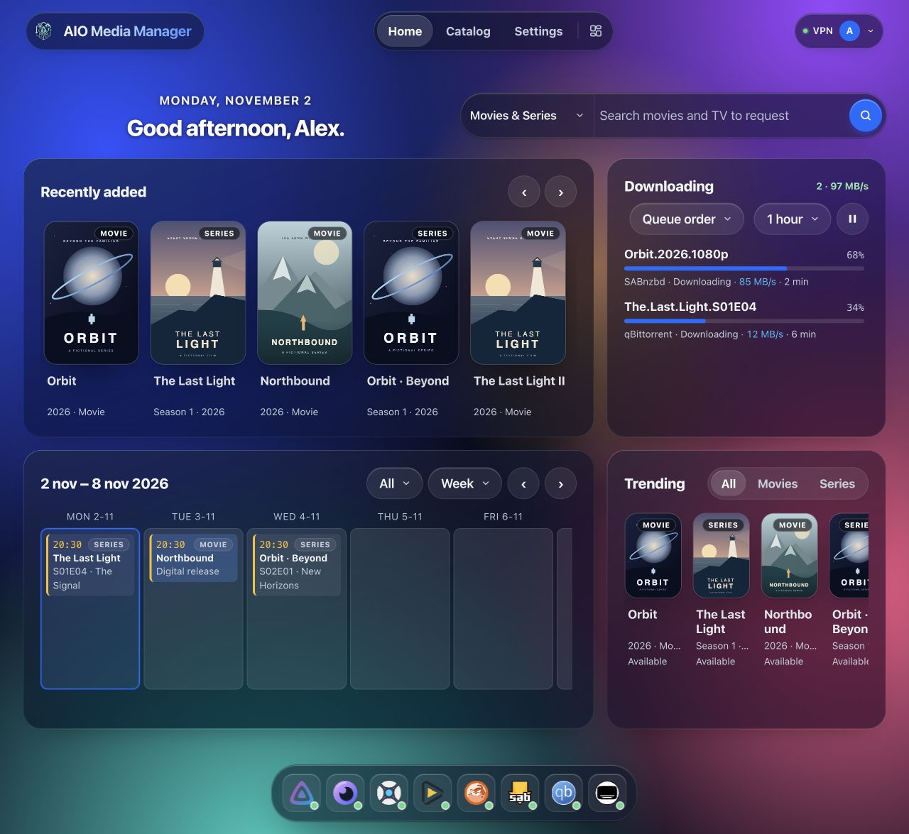

# Utiliser le tableau de bord — Avancé

!!! info "Avancé"
    Cette page est la référence technique. Pour une première installation, suivez le guide débutant. [Guide débutant](USAGE.md).

Ce guide s’adresse à vous une fois AIO installé et l’interface web ouverte.

!!! success "But"
    Terminez l’assistant pour les apps dont vous avez besoin, utilisez Accueil au quotidien, et **Ouvrir** dans le catalogue quand vous voulez l’écran de cet outil.

Adresse par défaut sur votre réseau local :

```text
http://YOUR-SERVER-IP:8080
```

Remplacez l’IP (et le port, si vous l’avez changé).

---

## Première fois

1. Créez le compte **administrateur** quand on vous le demande (nom, **e-mail**, mot de passe).
2. Terminez l’assistant de première exécution : les apps voulues, un serveur Usenet si vous en utilisez un, un VPN facultatif et un Cloudflare Tunnel facultatif. L’assistant installe ce choix. Le tunnel et le VPN démarrent dès que l’assistant est fini, si vous les avez activés.
3. Après une recréation du conteneur, le tableau de bord répond pendant que les apps démarrent encore. Avec le VPN activé, qBittorrent, Prowlarr et Flaresolverr attendent que la poignée de main WireGuard soit établie (AIO réessaie le VPN si le premier essai échoue). Cloudflare Tunnel démarre en dernier, une fois que les apps répondent, pour que cloudflared ne journalise pas de connection refused vers des origines qui n’écoutent pas encore.
4. Attendez que **Catalogue** affiche ces apps comme **actives**. Utilisez **Ouvrir** pour tout ce qui a encore un compte propre (Plex, Jellyfin, NZBGet).
5. Ajoutez-en plus tard depuis **Catalogue**. Vous n’avez pas besoin de chaque app.

Commencez petit (par exemple Radarr + un client de téléchargement + Jellyfin), puis ajoutez le reste.

---

**En-tête :** Accueil, Catalogue et Réglages restent centrés sur toute la largeur de l’en-tête. Sur les petits écrans, ils occupent une ligne centrée distincte. L’en-tête défile avec la page. Sur Accueil, le bouton de disposition se trouve à droite, près du compte. Toutes les pages, commandes et étiquettes de l’app utilisent Figtree ; si cette police ne peut pas être chargée, la même liste de polices système de remplacement s’applique partout.

## Organiser les widgets de l’accueil {#customize-home}

<div class="widget-visual-guide" role="group" aria-label="Organiser les widgets de l’accueil">
<div class="widget-visual-step"><span class="visual-number">1</span><strong>Le bouton de disposition</strong><div class="visual-nav"><span class="visual-nav-pages"><span>Home</span><span>Catalog</span><span>Settings</span></span><span class="visual-nav-tools"><span class="visual-highlight"><svg viewBox="0 0 24 24" fill="none" stroke="currentColor" stroke-width="1.7" aria-hidden="true"><rect x="3" y="3" width="7" height="10" rx="1.5"/><rect x="14" y="3" width="7" height="6" rx="1.5"/><rect x="3" y="17" width="7" height="4" rx="1.5"/><rect x="14" y="13" width="7" height="8" rx="1.5"/></svg></span><span aria-label="Compte">●</span></span></div><p>Sur Home, choisissez l’icône à quatre blocs à droite de l’en-tête, près du compte. Les poignées et la barre de modification apparaissent.</p></div>
<div class="widget-visual-step"><span class="visual-number">2</span><strong>Déplacer : glisser la poignée</strong><div class="visual-widget"><span class="visual-grip">⠿</span><span class="visual-remove">×</span><strong>Téléchargements</strong><span class="visual-widget-line"></span><span class="visual-widget-line short"></span><span class="visual-corner">↘</span></div><p>Taille : glisser ce coin</p></div>
<div class="widget-visual-step"><span class="visual-number">3</span><strong>Choisir un widget</strong><div class="visual-toolbar"><span>＋ Ajouter un widget</span><span>Terminé</span></div><p>Choisissez Ajouter un widget, puis Cette taille ou Toutes les tailles et le widget. Les changements sont enregistrés automatiquement ; terminez avec Terminé.</p></div>
</div>

[Essayer la démo interactive](index.md#app-preview){ .md-button .md-button--primary }

Ces illustrations expliquent les vraies commandes ; la démo du site utilise des données fictives et des mouvements simplifiés.

En mode édition, cliquez sur un widget pour ses tailles. × le retire de la taille d’écran choisie ; utilisez immédiatement Annuler si nécessaire.

Les changements sont enregistrés automatiquement dans votre profil AIO ; Terminé ferme l’éditeur. Téléphone, tablette et ordinateur peuvent avoir leur propre disposition. Les boutons de taille apparaissent uniquement quand la fenêtre peut les prévisualiser.

!!! tip "Tableau de bord"
    Pour une carte vide, vérifiez l’app source dans le catalogue. Réglages → Aide et diagnostic → Explain empty widgets peut expliquer pourquoi. Page d’accueil règle le dock ; Langue et apparence règle l’apparence.

Au clavier : Tab vers le widget, flèches pour déplacer, Maj + flèches pour redimensionner, Entrée pour les tailles, Suppr pour retirer.


## Accueil

Accueil est une grille. Téléphone, tablette et bureau gardent chacun leur disposition (4, 8 et 12 colonnes). Le bouton de disposition sur l’onglet Accueil déplace, agrandit, ajoute et retire des widgets. **Réglages → Page d’accueil** règle la barre d’apps et le texte de connexion. Les clés sont dans **Réglages → Connexions des apps**.

| Widget | Ce qu’il montre |
|--------|----------------|
| Salutation | Moment de la journée |
| Recherche | Recherche dans Seerr |
| Calendrier | Épisodes et films à venir. Une saison qui commence le même jour tient sur une ligne |
| Téléchargements | Téléchargements actifs, avec tout mettre en pause / tout reprendre. Les éléments bloqués peuvent être retirés |
| Ajouts récents | Nouvelles séries et films. Faire défiler charge d’autres pages Jellyfin. Plex reste aux 20 derniers |
| Demandes | Demandes Seerr pas encore prêtes, plus ce qui a été marqué disponible ou refusé ces 30 derniers jours |
| Tendances | La liste des tendances de Seerr. Faire défiler continue de charger |
| En lecture | Qui regarde sur Jellyfin ou Plex, y compris la lecture directe |
| Stockage | Utilisation disque de la config, des téléchargements et des médias |
| Serveur | CPU, mémoire et réseau. Avec `/sys` de l’hôte monté sur `/host/sys`, ce sont les cartes réseau du serveur. Sans ce montage, seulement le trafic de ce conteneur |
| À surveiller | Les mêmes contrôles que Réglages → Notifications, avec un lien pour régler chaque point |
| Autres téléchargements | Désactivé par défaut ; ajoutez-le via le contrôle de disposition. Ce que SABnzbd, NZBGet et qBittorrent ont téléchargé et qui n’est ni un film ni une série (musique, livres, jeux, logiciels, archives), chacun avec une icône pour son type |

Installer, démarrer, arrêter et **Ouvrir** se trouvent dans **Catalogue**. La barre en bas d’Accueil ouvre les apps déjà installées.

**Ouvrir** sur le LAN ressemble en général à `http://YOUR-SERVER-IP:8989` (exemple Sonarr).
Si vous avez configuré des noms d’hôte publics Cloudflare, **Ouvrir** peut utiliser `https://sonarr.yourdomain.com` à la place — voir [Cloudflare Tunnel](deploy/CLOUDFLARE.md).

---

## Ce que l’assistant relie

Dès qu’une app est saine — ou si vous cliquez sur **Liaison auto** — AIO règle les dossiers et catégories de téléchargement, les dossiers racines et les clients de téléchargement dans Sonarr, Radarr et Lidarr, la synchro Prowlarr, Seerr, le lien Bazarr, et les configurations de départ de Recyclarr et NeutArr. **Réglages → Usenet** enregistre le serveur de news et l’envoie à SABnzbd et NZBGet. Les indexeurs publics de départ sont désactivés par défaut. Activez-les explicitement dans l’assistant ou Réglages → Connexions des apps, puis lancez Liaison auto. Désactiver ce choix ne supprime pas les indexeurs existants. Retirez ce que vous ne voulez pas ; ils ne sont pas rajoutés.

SSD temporaire et bibliothèque HDD sont pris en charge ; les imports entre eux copient les fichiers. Les liens physiques exigent le même système de fichiers.

Encore à faire vous-même :

- Un compte Plex.
- Le jeton d’installation du premier démarrage de NeutArr (ci-dessous), jusqu’à ce que ce compte existe.
- La connexion à Jellyfin et NZBGet. Sur le LAN, **Ouvrir** vous connecte déjà à Sonarr, Radarr, Lidarr, Prowlarr, qBittorrent, SABnzbd, Bazarr et Seerr en tant qu’administrateur du gestionnaire. Les noms d’hôte publics montrent toujours la connexion propre de l’app.
- L’administrateur et l’assistant de première exécution de Seerr sont terminés pour vous à partir de cette connexion partagée (via Jellyfin, ou un Plex revendiqué).

VPN, Cloudflare Tunnel, Recyclarr, NeutArr et sauvegardes sont facultatifs.

### Jeton d’installation du premier démarrage de NeutArr

La première fois que NeutArr démarre, avant d’avoir un compte, il demande un jeton d’installation à usage unique.

1. Attendez que NeutArr soit **actif**.
2. Ouvrez **Catalogue → NeutArr → Réglages**.
3. Copiez **Jeton de première installation** et collez-le dans l’écran d’installation de NeutArr.

Cette valeur est le fichier `/config/neutarr/.setup-token` dans l’appliance (le dossier hôte monté comme `/config`). NeutArr supprime le fichier une fois le compte créé, et le champ dans Réglages se vide. Tant que NeutArr n’a pas démarré, le champ reste vide.

---

### Vérifications, progression et restauration

Avant une installation ou une mise à jour manuelle, AIO vérifie le stockage, la maintenance et l’accès aux téléchargements. Corrigez les blocages avant de continuer. **Catalogue → Progression des installations** affiche les étapes et les journaux en direct ; la fenêtre peut être fermée puis rouverte. Si la configuration échoue après l’installation, **Réessayer** relance uniquement le démarrage et les connexions.

Dans **Réglages → Connexions des apps → Vérifier mon installation**, AIO relit la configuration effective. **Liaison auto** applique la configuration automatique ; la vérification ne modifie aucun réglage des apps. Les indexeurs publics de départ nécessitent un choix explicite.

**Réglages → Sauvegardes** propose des copies HTTPS/WebDAV chiffrées et des tests de restauration dans un dossier temporaire. Conservez le mot de passe de chiffrement hors du serveur. **Notifications** inclut des seuils de stockage et l’historique des incidents. Recyclarr propose un mode manuel pour préserver exactement votre YAML.

Voir [vérifications et restauration](operations.md) et [sessions, HTTPS et récupération d’urgence](security-operations.md).

## Ouvrir l’interface de chaque app

| Situation | Ce que vous utilisez |
|-----------|-------------|
| À la maison en wifi | **Ouvrir** → `http://IP:PORT` |
| Hors de la maison avec Cloudflare | **Ouvrir** → `https://subdomain.yourdomain.com` |
| Vous avez changé le port d’écoute d’une app | AIO met à jour les routes publiées ; recréez le conteneur si les liens LAN ont encore l’air faux. Le port du gestionnaire lui-même est Compose/environnement (`AMM_API_PORT`), visible dans **Réglages → Serveur et stockage** |

Si **Ouvrir** échoue :

- L’app est-elle **active** dans le catalogue ?
- Êtes-vous sur le même réseau (pour les liens LAN) ?
- Pour les liens HTTPS : le tunnel est-il connecté et **Publier** a-t-il réussi ? ([Guide Cloudflare](deploy/CLOUDFLARE.md))

---

## Utiliser le nouveau catalogue {#catalog-menu}

Ouvrez **Catalogue** en haut. Choisissez la vue à gauche ; les apps apparaissent à droite.

Cliquez sur le nom, l’icône ou la ligne d’une app pour ouvrir sa **fenêtre de réglages**, sans ouvrir l’app elle-même. **⋯** propose selon son état Réglages, Arrêter, Redémarrer, Journaux, Mettre à jour et Désinstaller. Fermez avec × ou Échap. Enregistrez uniquement les changements souhaités.

Les **réglages d’app dans Catalogue** concernent une app. La page **Réglages** en haut concerne AIO : profil, apparence, connexions, sauvegardes et mises à jour.

[Utiliser le nouveau catalogue](USAGE.md#catalog-menu).

Réglages utilise la même disposition que le catalogue : groupe et page à gauche, contenu à droite. La recherche filtre le menu, pas les valeurs enregistrées. Faites défiler le menu pour voir les groupes du bas. Sur téléphone, ouvrez **Sections des réglages**, puis choisissez une page.

## Les réglages que vous utilisez vraiment

Les noms dans l’interface peuvent être courts ; voici ce qu’ils veulent dire en pratique.

| Page à choisir | Que voulez-vous modifier ? |
|---|---|
| **Profil** | Compte, photo et mot de passe. |
| **Langue et apparence** | Langue, thème, fond et logos. |
| **Page d’accueil** | Barre d’apps et texte de connexion ; disposition des widgets sur Accueil. |
| **VPN** | Connexion VPN des apps compatibles. |
| **Accès externe** | Cloudflare Tunnel, adresses publiques et proxys de confiance. |
| **Connexions des apps** | Clés Jellyfin/Seerr, association TV et accès Homey en lecture seule. |
| **Usenet** | Fournisseur Usenet pour SABnzbd et NZBGet. |
| **Mises à jour** | Mises à jour des apps et planification. AIO se met à jour via le NAS/Docker. |
| **Sauvegardes** | Créer, vérifier, planifier et restaurer les sauvegardes de configuration. |
| **Notifications** | Alertes par e-mail et Discord. |
| **Serveur et stockage** | Fuseau horaire, journaux, permissions et stockage. Modifier les montages sur le serveur. |
| **Aide et diagnostic** | Expliquer les widgets vides et recueillir le diagnostic. |
| **À propos de cette app** | Version, installation sur votre appareil et soutien du projet. |

Laissez aux apps un moment pour se recharger après un changement important de réseau ou de port — ou redémarrez AIO si les liens restent périmés.

## Écrans {#screens}

Interface actuelle avec données fictives. Clair à gauche, sombre à droite. Accueil montre affiches, téléchargements et dates de sortie. Les captures utilisent les noms de menu anglais.

### Tableau de bord

| Light | Dark |
|---|---|
|  |  |

### Accès externe

| Light | Dark |
|---|---|
|  |  |

### Connexions des apps

| Light | Dark |
|---|---|
|  |  |

### À propos de cette app

| Light | Dark |
|---|---|
|  |  |

### Profil

| Clair | Sombre |
| --- | --- |
|  |  |

### Langue et apparence

| Clair | Sombre |
| --- | --- |
|  |  |

### Serveur et stockage

| Clair | Sombre |
| --- | --- |
|  |  |

### Mises à jour

| Clair | Sombre |
| --- | --- |
|  |  |

### Sauvegardes

| Clair | Sombre |
| --- | --- |
|  |  |

### VPN

| Clair | Sombre |
| --- | --- |
|  |  |

### Notifications

| Clair | Sombre |
| --- | --- |
|  |  |

### Usenet

| Clair | Sombre |
| --- | --- |
|  |  |

### Page d’accueil

| Clair | Sombre |
| --- | --- |
|  |  |

### Aide et diagnostic

| Clair | Sombre |
| --- | --- |
|  |  |

### Réglages d’app dans le catalogue

| Clair | Sombre |
| --- | --- |
|  |  |

---

## Sauvegardes

- Utilisez la sauvegarde intégrée si vous avez une installation à conserver.
- Sauvegardez aussi le dossier **config** sur l’hôte (et le montage des sauvegardes si vous en utilisez un).
- Les fichiers média sont à part — sauvegardez-les avec votre stratégie NAS ou disque habituelle.

---

## Mettre à jour les apps et mettre à jour AIO

| Quoi | Comment |
|------|-----|
| **AIO lui-même** (tableau de bord + superviseur) | Tirez une nouvelle image Docker et **recréez le conteneur** ([Installer](INSTALL.md)). Réglages → Mises à jour indique seulement quand `:latest` a bougé |
| **Apps installées** (Sonarr, Seerr et le reste) | **Réglages → Mises à jour**. Mettez à jour une app ou toutes. La progression est là, et Catalogue et Accueil affichent **Mise à jour…**. Le tableau de bord continue de répondre. Les planifications sont **désactivées** par défaut |

L’image ne met pas ces apps à jour toute seule. Lisez les notes de version sur GitHub si quelque chose d’important a changé.

---

## Accrocs fréquents

| Problème | Essayez ceci |
|---------|----------|
| Écran vide ou boucle de connexion sur une app | Effacez les données du site pour cette URL ; vérifiez que l’app tourne |
| NeutArr demande un jeton d’installation | **Catalogue → NeutArr → Réglages** une fois NeutArr démarré. Le jeton disparaît dès que le compte NeutArr existe |
| Erreurs de droits à l’écriture | Le propriétaire du dossier hôte doit correspondre à l’utilisateur du conteneur (`PUID`/`PGID`) |
| Sonarr importe mais copie les fichiers | Téléchargements et médias doivent partager un système de fichiers pour les liens physiques |
| Ça marche à la maison, pas en données mobiles | Il faut un tunnel (+ Access de préférence) ; les IP du LAN ne sont pas joignables en données mobiles |
| Deux Sonarr en conflit | Retirez un conteneur Sonarr supplémentaire ; seul AIO doit le faire tourner |
| Le graphique serveur ne compte que ce conteneur | Montez `/sys` de l’hôte en lecture seule sur `/host/sys` et recréez ([Docker](deploy/DOCKER.md)) |
| Ajouts récents Jellyfin semblent courts | Faites défiler la rangée — d’autres pages se chargent. Si la rangée reste vide, mettez une clé d’API Jellyfin dans **Réglages → Page d’accueil** |
| Ajouts récents Plex s’arrêtent à 20 | Cette liste, ce sont les 20 derniers de Plex |
| qBittorrent / Prowlarr / Flaresolverr restent arrêtés après le boot | Le VPN est actif sans poignée de main. Vérifiez **Réglages → VPN** ; AIO réessaie le tunnel et démarre ces apps quand il est à nouveau up. Un **Stop** manuel du VPN annule cette reprise |
| Indexeurs Prowlarr indisponibles / échecs RSS | Souvent un délai DNS via le VPN. Après une mise à jour d’AIO, recréez le conteneur, puis **Test All** dans Prowlarr (et retestez dans Sonarr/Radarr) pour effacer l’ancien backoff. Un partage de diagnostic montre les hits du cache DNS VPN et les échecs par résolveur |
| cloudflared journalise connection refused au boot | Attendu sur les anciennes images où le tunnel démarrait avant les apps. Les images actuelles démarrent Cloudflare en dernier ; recréez depuis un `nightly` / `latest` actuel |

---

## Et ensuite

- Liste pour une nouvelle installation : [Installer](INSTALL.md)
- Accès distant : [Cloudflare Tunnel](deploy/CLOUDFLARE.md)
- Fermer la porte des URL publiques : [Cloudflare Access](deploy/CLOUDFLARE_ACCESS.md)
