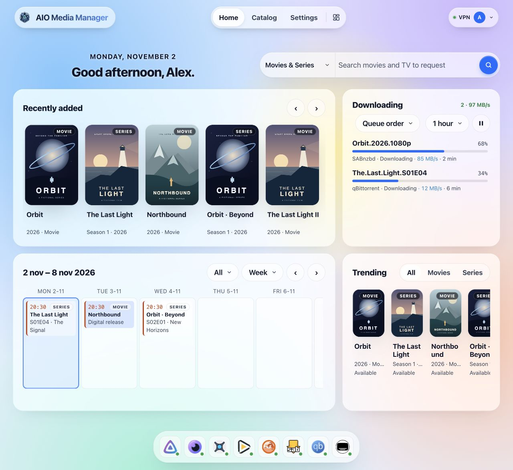
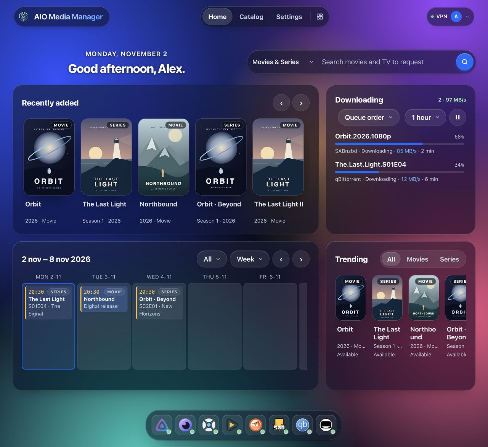

# Using the dashboard — Advanced

!!! info "Advanced"
    This is the technical reference. For a first installation, follow the beginner guide instead. [Beginner guide](USAGE.md).

This guide is for after AIO is installed and you can open the web UI.

!!! success "Goal"
    Finish the wizard for the apps you need, use Home day to day, and use **Open** on Catalog whenever you want that tool’s screen.

Default address on your home network:

```text
http://YOUR-SERVER-IP:8080
```

Replace the IP (and port, if you changed it).

---

## First time

1. Create the **admin** account when prompted (username, **email**, password).
2. Finish the first-run wizard: the apps you want, a Usenet server if you use one, optional VPN, and an optional Cloudflare Tunnel. The wizard installs that selection. The tunnel and the VPN start as soon as it finishes, when you turned them on.
3. After a container recreate, the dashboard answers while apps are still starting. With VPN on, qBittorrent, Prowlarr, and Flaresolverr wait until the WireGuard handshake is up (AIO retries the VPN if the first try fails). Cloudflare Tunnel starts last, after the apps answer, so cloudflared does not log connection refused against origins that are not listening yet.
4. Wait until **Catalog** shows those apps as **running**. Use **Open** for anything that still has its own account (Plex, Jellyfin, NZBGet).
5. Add more later from **Catalog**. You do not need every app.

Start small (for example Radarr + one download client + Jellyfin), then add the rest.

---

## Arrange your Home widgets {#customize-home}

<div class="widget-visual-guide" role="group" aria-label="Arrange your Home widgets">
<div class="widget-visual-step"><span class="visual-number">1</span><strong>The edit button</strong><div class="visual-nav"><span>Home</span><span>Catalog</span><span>Settings</span><span class="visual-highlight"><svg viewBox="0 0 24 24" fill="none" stroke="currentColor" stroke-width="1.7" aria-hidden="true"><rect x="3" y="3" width="7" height="10" rx="1.5"/><rect x="14" y="3" width="7" height="6" rx="1.5"/><rect x="3" y="17" width="7" height="4" rx="1.5"/><rect x="14" y="13" width="7" height="8" rx="1.5"/></svg></span></div><p>On Home, choose the four-block layout icon next to the page tabs. Widget handles and an editing toolbar appear.</p></div>
<div class="widget-visual-step"><span class="visual-number">2</span><strong>Move: drag the grip</strong><div class="visual-widget"><span class="visual-grip">⠿</span><span class="visual-remove">×</span><strong>Downloading</strong><span class="visual-widget-line"></span><span class="visual-widget-line short"></span><span class="visual-corner">↘</span></div><p>Resize: drag this corner</p></div>
<div class="widget-visual-step"><span class="visual-number">3</span><strong>Choose what to add</strong><div class="visual-toolbar"><span>＋ Add widget</span><span>Done</span></div><p>Choose Add widget, pick This size or Every size, then choose a widget. Changes save automatically; choose Done when finished.</p></div>
</div>

[Try the interactive example](index.md#app-preview){ .md-button .md-button--primary }

This is a visual explanation of the real controls; the website demo uses sample data and simplified movement.

Click a widget while editing to open its size choices. The × removes it from the selected screen size; use Undo immediately if you removed the wrong one.

Changes save automatically to your AIO profile; Done closes editing. A separate phone/tablet/desktop layout means changing desktop does not always change your phone. The size buttons only appear when the window can preview those sizes.

!!! tip "Dashboard"
    For an empty card, first check its source app in Catalog. Settings → Help and diagnostics → Explain empty widgets can show why content is missing. Settings → Start page also controls the app dock; Settings → Language and appearance changes the look.

On a keyboard: Tab to a widget while editing; arrow keys move it, Shift + arrows resize, Enter opens size choices, and Delete removes it.


## Home

Home is a grid. Phone, tablet, and desktop each keep their own layout (4, 8, and 12 columns). The layout control on the Home tab moves, resizes, adds, and removes widgets. **Settings → Start page** shows or hides the app dock and sets the sign-in message. Keys are under **Settings → App connections**.

| Widget | What it shows |
|--------|----------------|
| Greeting | Time of day |
| Search | Seerr search |
| Calendar | Upcoming episodes and movies. A season that lands on one day is one entry |
| Downloading | Active downloads, with pause all / resume all. Stuck items can be removed |
| Recently added | New shows and movies. Scrolling loads further Jellyfin pages. Plex stays on its latest 20 |
| Requests | Seerr requests that are not finished, plus ones marked available or declined in the last 30 days |
| Trending | Seerr's trending list. Scrolling keeps loading |
| Now playing | Who is watching on Jellyfin or Plex, including direct play |
| Storage | Disk use for config, downloads, and media |
| Server | CPU, memory, and network. With host `/sys` mounted at `/host/sys`, this is the server's network cards. Without that mount it is only this container's traffic |
| Needs attention | The same checks as Settings → Notifications, with a link to fix each one |
| Other downloads | Off by default; add it from the layout control. What SABnzbd, NZBGet, and qBittorrent downloaded that is not a film or series (music, books, games, software, archives), each with an icon for its kind |

Install, start, stop, and **Open** live on **Catalog**. The dock at the bottom of Home opens apps that are already installed.

LAN **Open** usually looks like `http://YOUR-SERVER-IP:8989` (example for Sonarr).
If you set up Cloudflare public hostnames, **Open** can instead use `https://sonarr.yourdomain.com` — see [Cloudflare Tunnel](deploy/CLOUDFLARE.md).

---

## What the wizard wires

After an app is healthy — or when you click **Auto-Wire** — AIO sets download folders and categories, root folders and download clients in Sonarr, Radarr, and Lidarr, Prowlarr sync, Seerr, Bazarr pairing, and starter configs for Recyclarr and NeutArr. **Settings → Usenet** holds the news server and sends it to SABnzbd and NZBGet. Prowlarr also gets a starter set of public indexers. Remove any you do not want; they are not added back.

SSD staging and an HDD library are supported; imports across them copy files. Hardlinks require the same filesystem.

Still yours to finish:

- A Plex account.
- NeutArr's first-run setup token (below), until that account exists.
- Signing in to Jellyfin and NZBGet. On the LAN, **Open** already signs in Sonarr, Radarr, Lidarr, Prowlarr, qBittorrent, SABnzbd, Bazarr, and Seerr as the manager admin. Public hostnames always show the app's own login.
- Seerr's admin and first-run wizard are completed for you from that shared login (through Jellyfin, or a claimed Plex).

VPN, Cloudflare Tunnel, Recyclarr, NeutArr, and backups are optional.

### NeutArr first-run setup token

The first time NeutArr starts, before it has an account, it asks for a one-time setup token.

1. Wait until NeutArr shows as **running**.
2. Open **Catalog → NeutArr → Settings**.
3. Copy **First-run setup token** and paste it into NeutArr's setup screen.

That value is the file `/config/neutarr/.setup-token` inside the appliance (the host folder mounted as `/config`). NeutArr deletes the file after the account is created, and the Settings field goes empty. Until NeutArr has started, the field stays empty.

---

## Opening each app’s UI

| Situation | What to use |
|-----------|-------------|
| At home on Wi‑Fi | **Open** → `http://IP:PORT` |
| Away from home with Cloudflare | **Open** → `https://subdomain.yourdomain.com` |
| You changed an app’s listen port | AIO updates published routes; recreate the container if LAN links still look wrong. The manager port itself is compose/env (`AMM_API_PORT`), shown on **Settings → Server and storage** |

If **Open** fails:

- Is the app **running** on Catalog?
- Are you on the same network (for LAN links)?
- For HTTPS links: is the tunnel connected and was **Publish** successful? ([Cloudflare guide](deploy/CLOUDFLARE.md))

---

## Using the new catalog {#catalog-menu}

Open **Catalog** at the top. The left sidebar helps you choose what to see; the apps appear on the right.

Click an app’s name, icon or row to open its **app settings popup**. This does not open the app itself. The **⋯** button offers Settings, Stop, Restart, Logs, Update and Uninstall as applicable. Close the popup with × or Escape. Only save changes when you intend to change that app.

**Catalog app settings** change one app. The **Settings** page in the top navigation changes AIO itself: profile, appearance, connections, backups and updates.

[Using the new catalog](USAGE.md#catalog-menu).

The settings page uses the same sidebar-and-content layout as the catalog. On a computer, choose a group and page on the left; the selected page appears on the right. The search field filters the menu, not the values of your settings. Scroll the sidebar to find lower groups. On a phone, open **Settings sections** and choose a page.

## Settings you will actually use

Names in the UI may be short labels; here is what they mean in practice.

| Choose this page | What do you want to change? |
|---|---|
| **Profile** | Your account, photo and password. |
| **Language and appearance** | Language, theme, wallpaper and branding. |
| **Start page** | App dock and sign-in message; widget layout is edited on Home. |
| **VPN** | The VPN connection for supported apps. |
| **External access** | Cloudflare Tunnel, public hostnames and trusted proxies. |
| **App connections** | Jellyfin/Seerr keys, TV pairing and read-only Homey connections. |
| **Usenet** | Usenet provider details for SABnzbd and NZBGet. |
| **Updates** | App updates and schedules. AIO itself is updated through your NAS/Docker. |
| **Backups** | Create, check, schedule and restore configuration backups. |
| **Notifications** | Email and Discord alerts. |
| **Server and storage** | Timezone, logs, permissions and storage paths. Change mounts on the host. |
| **Help and diagnostics** | Explain empty widgets and collect diagnostic information. |
| **About this app** | Version, install on your device and project support. |

After changing important network or port settings, give apps a moment to reload — or restart AIO if links still look stale.

## Screens

Current app interface with fictional example data. Light is on the left, dark on the right. The filled Home screen shows posters, downloads and episode/movie release dates. Screenshots use English interface labels.

### Dashboard

| Light | Dark |
|---|---|
|  |  |

### External access

| Light | Dark |
|---|---|
|  |  |

### App connections

| Light | Dark |
|---|---|
|  |  |

### About this app

| Light | Dark |
|---|---|
|  |  |

### Profile

| Light | Dark |
| --- | --- |
|  |  |

### Language and appearance

| Light | Dark |
| --- | --- |
|  |  |

### Server and storage

| Light | Dark |
| --- | --- |
|  |  |

### Updates

| Light | Dark |
| --- | --- |
|  |  |

### Backups

| Light | Dark |
| --- | --- |
|  |  |

### VPN

| Light | Dark |
| --- | --- |
|  |  |

### Notifications

| Light | Dark |
| --- | --- |
|  |  |

### Usenet

| Light | Dark |
| --- | --- |
|  |  |

### Start page

| Light | Dark |
| --- | --- |
|  |  |

### Help and diagnostics

| Light | Dark |
| --- | --- |
|  |  |

### Catalog app settings

| Light | Dark |
| --- | --- |
|  |  |

---

## Backups

- Use the built-in backup feature when you have a setup you like.
- Also back up the **config** folder on the host (and the backups mount if you use one).
- Media files are separate — back those up with your normal NAS/disk strategy.

---

## Updating apps vs updating AIO

| What | How |
|------|-----|
| **AIO itself** (dashboard + supervisor) | Pull a new Docker image and **recreate** the container ([Install](INSTALL.md)). Settings → Updates only tells you when `:latest` moved |
| **Installed apps** (Sonarr, Seerr, and the rest) | **Settings → Updates**. Update one app or all of them. Progress shows there, and Catalog and Home show **Updating…**. The dashboard keeps answering. Schedules default to **off** |

The image does not bump those apps on its own. Read release notes on GitHub if something major changed.

---

## Common snags

| Problem | Try this |
|---------|----------|
| Blank or login loop on an app | Clear site data for that URL; confirm the app is running |
| NeutArr asks for a setup token | **Catalog → NeutArr → Settings** after NeutArr is running. The token is removed once the NeutArr account exists |
| Permission errors writing files | Host folder owner must match the container user (`PUID`/`PGID`) |
| Sonarr imports but duplicates files | Downloads and media must share one filesystem for hardlinks |
| Works at home, not on phone data | Need Tunnel (+ ideally Access); LAN IPs are not reachable from mobile data |
| Two Sonarrs fighting | Remove any extra Sonarr container; only AIO should run it |
| Server graph counts only this container | Mount host `/sys` read-only at `/host/sys` and recreate ([Docker](deploy/DOCKER.md)) |
| Jellyfin recently added looks short | Scroll the rail — it loads further pages. If the rail stays empty, set a Jellyfin API key under **Settings → App connections** |
| Plex recently added stops at 20 | That list is Plex's latest 20 |
| qBittorrent / Prowlarr / Flaresolverr stay stopped after boot | VPN is on without a live handshake. Check **Settings → VPN**; AIO retries the tunnel and starts those apps when it is up. A manual VPN **Stop** cancels the retry |
| Prowlarr indexers unavailable / RSS failures | Often a DNS timeout through the VPN. After updating AIO, recreate the container, then **Test All** in Prowlarr (and re-test in Sonarr/Radarr) so the old failure backoff clears. A debug share shows VPN DNS cache hits and per-resolver failures |
| cloudflared logs connection refused at boot | Expected on older images when the tunnel started before apps. Current images start Cloudflare last; recreate from a current `nightly` / `latest` |

---

## Next steps

- New install checklist: [Install](INSTALL.md)
- Remote access: [Cloudflare Tunnel](deploy/CLOUDFLARE.md)
- Lock the door on public URLs: [Cloudflare Access](deploy/CLOUDFLARE_ACCESS.md)
